# DEV_MAP — development map of the database

Generated by `python tools/dev_map.py` from `nogamy/examples/acme-sales/db/`. Do not edit by hand.

Box = table · rounded = view · arrow = data flow (label = load procedure) · dotted = dependency on another entity · dashed border = `TRY_`.

```mermaid
flowchart LR
  subgraph BRONZE
    BRONZE__BRONZE_ERP_CUSTOMERS["BRONZE_ERP_CUSTOMERS"]
  end
  subgraph SILVER
    SILVER__SILVER_SALES_DIM_CUSTOMER["SILVER_SALES_DIM_CUSTOMER"]
    SILVER__V_SALES_DIM_CUSTOMER_FINAL_STEP(["V_SALES_DIM_CUSTOMER_FINAL_STEP"])
    SILVER__V_SALES_DIM_CUSTOMER_STEP1_SOURCE(["V_SALES_DIM_CUSTOMER_STEP1_SOURCE"])
  end
  subgraph GOLD
    GOLD__SALES_DIM_CUSTOMER["SALES_DIM_CUSTOMER"]
  end
  BRONZE__BRONZE_ERP_CUSTOMERS --> SILVER__V_SALES_DIM_CUSTOMER_STEP1_SOURCE
  SILVER__SILVER_SALES_DIM_CUSTOMER -->|SP_SALES_DIM_CUSTOMER| GOLD__SALES_DIM_CUSTOMER
  SILVER__V_SALES_DIM_CUSTOMER_FINAL_STEP -->|SP_SALES_DIM_CUSTOMER| SILVER__SILVER_SALES_DIM_CUSTOMER
  SILVER__V_SALES_DIM_CUSTOMER_STEP1_SOURCE --> SILVER__V_SALES_DIM_CUSTOMER_FINAL_STEP
```

## Dependencies between entities

None.
