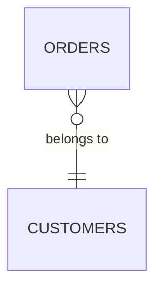

# Relationships — <system>

The table is the source of truth; the diagram is a view of it. `meaning_he` is what the semantic model will need later; `notes` is what the reviewer will check (orphans, duplicates). `evidence` says how we know: a declared key, a legacy script line, a count.

| from | to | cardinality | join | meaning_he | evidence | notes |
|---|---|---|---|---|---|---|
| ORDERS | CUSTOMERS | N:1 | ORDERS.CUSTOMER_ID = CUSTOMERS.CUSTOMER_ID | הזמנה שייכת ללקוח | legacy script, section Orders | 2% orphans |

