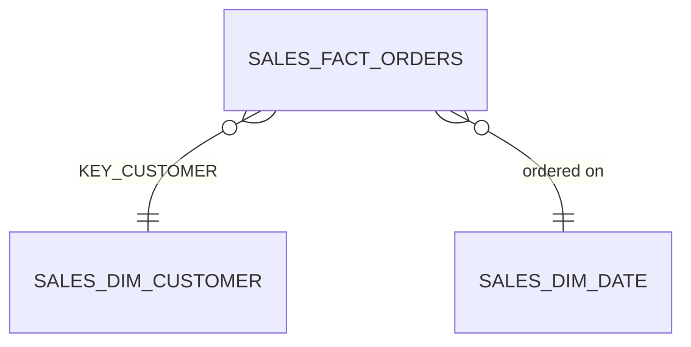

# Relationships — <domain> star model

Names: `nogamy-naming` skill. Every join is on `KEY_<ENTITY>`, the same column name in the fact and in the dimension.

| from (fact) | to (dim) | cardinality | join | meaning_he | active | notes |
|---|---|---|---|---|---|---|
| GOLD.SALES_FACT_ORDERS | GOLD.SALES_DIM_CUSTOMER | N:1 | KEY_CUSTOMER | הזמנה של לקוח | yes | |
| GOLD.SALES_FACT_ORDERS | GOLD.SALES_DIM_DATE | N:1 | KEY_ORDER_DATE → KEY_DATE | תאריך הזמנה | yes | role-playing date |
| GOLD.SALES_FACT_ORDERS | GOLD.SALES_DIM_DATE | N:1 | KEY_SHIP_DATE → KEY_DATE | תאריך משלוח | no | inactive; activated by the measure that needs it |

